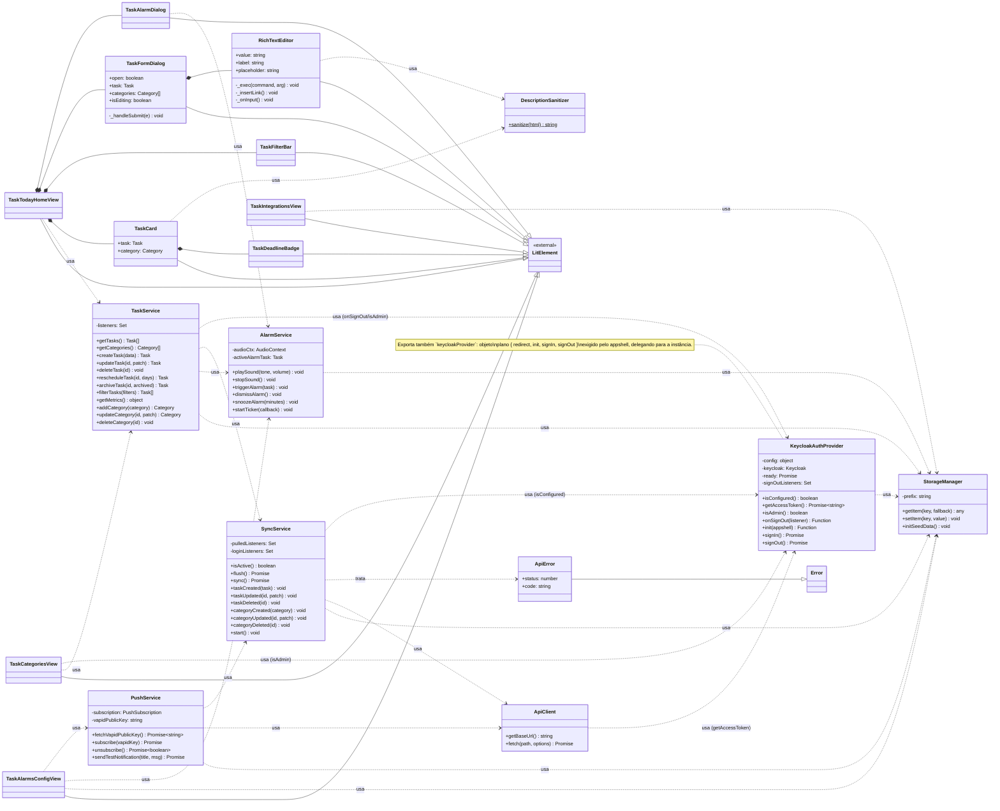

# Diagrama de Classes — Task Today App

Visão geral das classes do front-end (`src/`) depois da refatoração para orientação a
objetos da camada de serviços. Todos os componentes de UI já eram classes (`LitElement`);
`StorageManager`, `KeycloakAuthProvider`, `ApiClient` e `DescriptionSanitizer` eram módulos
de funções soltas e passaram a encapsular seu próprio estado em classes.

Cada serviço é exportado como uma instância única (singleton), ex.: `export const
taskService = new TaskService()`.

## Notas de projeto

- **Singletons com estado encapsulado**: cada serviço guarda seu estado (fila de
  sincronização, contexto de áudio, listeners, inscrição push, sessão Keycloak) como
  campos de instância, em vez de variáveis de módulo soltas.
- **`keycloakProvider`**: o appshell (`fzl-fund-appshell--lit`) espera um objeto simples
  com `redirect`/`init`/`signIn`/`signOut` como propriedades próprias. Por isso ele
  continua sendo exportado como um objeto plano que delega para `KeycloakAuthProvider`,
  em vez da própria instância da classe.
- **`DescriptionSanitizer`**: utilitário sem estado (métodos estáticos) usado tanto no
  `rich-text-editor` (ao salvar) quanto no `task-card` (ao renderizar), como defesa em
  profundidade contra HTML malicioso na descrição da tarefa.
